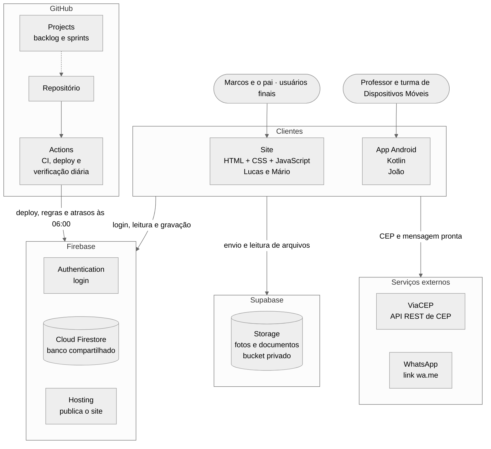
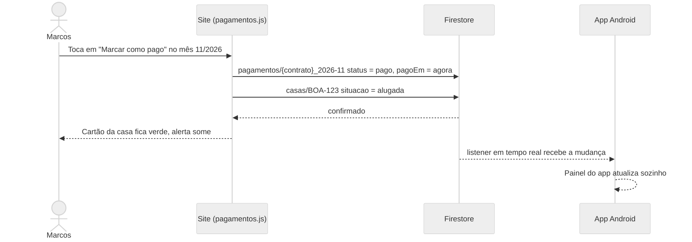

# Arquitetura

O site (para o Marcos e o pai dele) e o app Android (para a disciplina de Dispositivos Móveis) são dois clientes do **mesmo banco de dados**. Não existe servidor próprio: os dados e o login ficam no Firebase, e as fotos e documentos ficam no Supabase Storage. A única parte que roda "no servidor" é a verificação diária de atrasos, feita pelo GitHub Actions.

## Camadas

| Camada | Site (web/) | App (mobile/) |
| --- | --- | --- |
| Telas | `*.html` + `css/` | Activities, Fragments e layouts XML |
| Lógica da tela | `js/pages/*.js` | ViewModels (ou a própria Activity/Fragment) |
| Acesso a dados | `js/services/*.js` (Firebase JS SDK) | `data/repository/*` (Firebase Android SDK) |
| Regras de negócio | `js/utils/*.js` | `domain/*` em Kotlin, seguindo `docs/regras-de-negocio.md` |
| Serviço web | `js/services/viacep.js` (fetch) | `data/remote/ViaCepApi.kt` (Retrofit) |

## Fluxo de uma ação (exemplo: registrar pagamento)

## Decisões principais

- **Firebase para dados e login.** O Firestore tem SDK oficial para JavaScript e Kotlin, login pronto, funciona offline no Android e atualiza as telas em tempo real.
- **Sem servidor próprio.** O plano gratuito do Firebase (Spark) não roda Cloud Functions, então a verificação diária de atrasos roda como um script Node no GitHub Actions, com a conta de serviço guardada como secret.
- **Regras de negócio escritas uma vez e copiadas com cuidado.** O código da casa e o cálculo da situação estão em `web/js/utils/` e documentados em `docs/regras-de-negocio.md`. O app em Kotlin precisa seguir exatamente o mesmo documento.
- **Fotos e documentos no Supabase Storage.** O Firebase Storage passou a exigir o plano pago. O Firestore guarda só o caminho do arquivo, e o arquivo fica num bucket privado do Supabase. Ver `docs/decisoes.md`.
