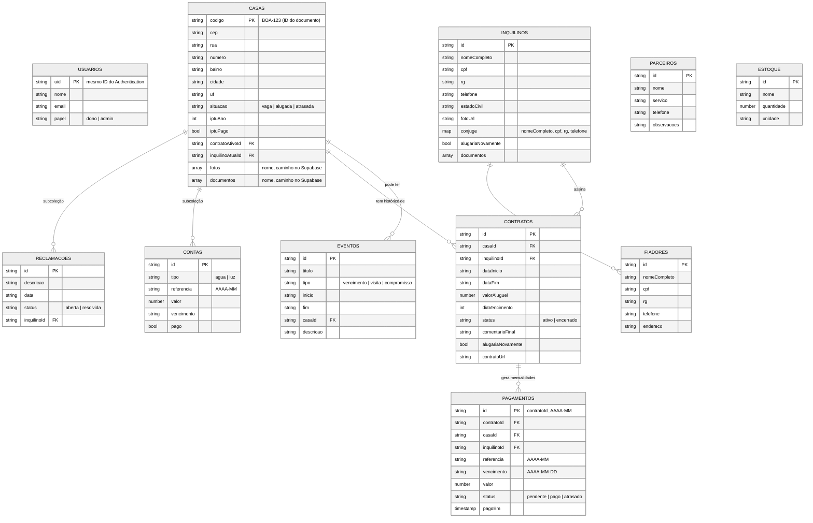

# Modelagem do banco (Cloud Firestore)

O Firestore guarda **documentos** dentro de **coleções**. Não existe JOIN: quando uma tela precisa de dados de duas coleções, guardamos o ID de uma na outra (ex.: `contratos.casaId`) e, quando ajuda o painel a carregar rápido, repetimos um campo (ex.: `casas.situacao`).

Convenções usadas nas duas aplicações:

- Nomes de campos em português, em camelCase, sem acento.
- **Datas de negócio** (vencimento, início de contrato, evento) como texto `AAAA-MM-DD`. Assim web e Kotlin comparam do mesmo jeito e não há problema de fuso.
- **Datas de registro** (`criadoEm`, `atualizadoEm`, `pagoEm`) como `Timestamp` do servidor.
- Valores em reais como número (`1200.5`).

## Diagrama

## Coleções

| Caminho | Para que serve | Quem cria |
| --- | --- | --- |
| `usuarios/{uid}` | Lista de quem pode usar o sistema (Marcos e equipe). Sem esse documento, as regras bloqueiam tudo. | Mário, à mão no console |
| `casas/{codigo}` | Cada casa. O ID é o próprio código (BOA-123), o que impede código repetido. | Site e app |
| `casas/{codigo}/reclamacoes/{id}` | Reclamações daquela casa | Site |
| `casas/{codigo}/contas/{id}` | Contas de água (Compesa) e luz (Celpe), lançadas à mão | Site |
| `inquilinos/{id}` | Cada inquilino, com o cônjuge dentro do próprio documento | Site e app |
| `inquilinos/{id}/fiadores/{id}` | Fiadores do inquilino | Site |
| `contratos/{id}` | Liga inquilino e casa. Os encerrados formam o histórico da casa. | Site e app |
| `pagamentos/{contratoId}_{AAAA-MM}` | Uma mensalidade por contrato e mês. O ID fixo evita mensalidade duplicada. | Site, app e verificação diária |
| `eventos/{id}` | Compromissos e visitas do calendário (os vencimentos são lidos de `pagamentos`) | Site |
| `parceiros/{id}` | Prestadores de serviço | Site |
| `estoque/{id}` | Materiais | Site |

## Consultas principais e índices

| Tela | Consulta | Índice |
| --- | --- | --- |
| Painel | todas as `casas` ordenadas por `codigo` | automático |
| Histórico da casa | `contratos` onde `casaId == X`, ordem `dataInicio` desc | `firebase/firestore.indexes.json` |
| Pagamentos da casa | `pagamentos` onde `casaId == X`, ordem `referencia` desc | `firebase/firestore.indexes.json` |
| Alertas | `pagamentos` onde `status == atrasado`, ordem `vencimento` | `firebase/firestore.indexes.json` |

## Dados pessoais (LGPD)

RG, CPF, telefones e contratos são dados pessoais. Por isso:

- Só usuários listados em `usuarios/` leem ou gravam qualquer coisa (`firebase/firestore.rules`).
- Fotos e documentos ficam num bucket **privado** do Supabase Storage; o Firestore guarda só o caminho.
- Nenhum dado real vai para o repositório. Os dados de demonstração são inventados.
